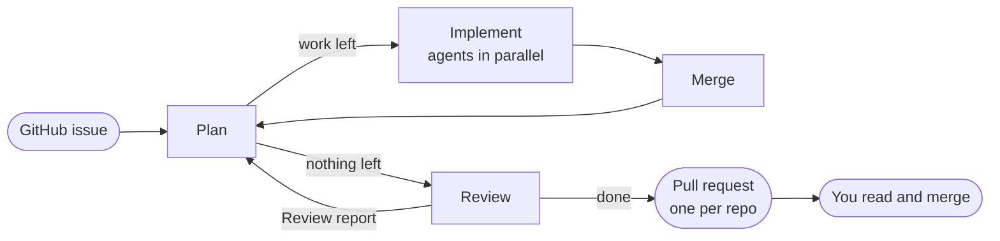
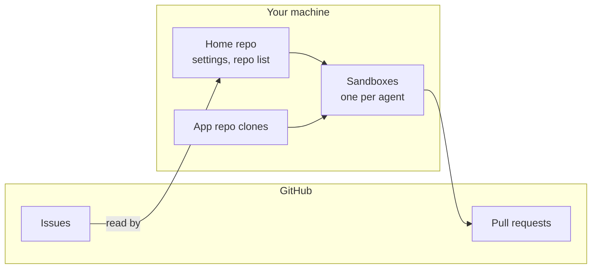

# sandcastle-factory

Hand it a GitHub issue, walk away, come back to a pull request. AI agents plan the work, write the code in parallel sandboxes, review it, and open one PR per repo they touched. Nobody is asked anything mid-run. Built on [`@ai-hero/sandcastle`](https://github.com/ai-hero-dev/sandcastle).

## Requirements and limits

- **Tools**: Node 22+, git, [`gh`](https://cli.github.com) (logged in). Windows: git bash.
- **Sandboxes**: docker or podman. Without them, see `SANDBOX=none` below.
- **GitHub only**: GitLab, Bitbucket and others are not supported. The home repo needs issues enabled and a Kanban (below).
- **Kanban**: a GitHub Project whose Status has exactly `Backlog`, `Ready for agent`, `Agent working`, `In review`, `Done`, and the built-in workflows Item closed → Done and Item reopened → Ready for agent on. The factory refuses to start when the Status options differ; a switched-off workflow fails the run at the first move that needs it.
- **One machine**: a second `take`/`resume` on a root with a live run on this machine is refused ([ADR-0009](docs/adr/0009-a-run-claims-its-root-through-a-named-pipe.md)); runs on two machines are not detected.
- **Token** `GH_TOKEN`, one for every Workspace repo and the Kanban. Its kind follows the Kanban's owner:
  - Kanban of a personal account: a classic token (`repo`, `project`, `workflow`, `read:org`, `read:discussion`). Fine-grained tokens cannot reach a user-owned Project.
  - Kanban of an organisation: a fine-grained token for that organisation is enough. Repository access: every Workspace repo. Repository permissions: Contents, Issues, Pull requests, Workflows read/write; Metadata read. Organisation permissions: Projects read/write.

  Agents get `GH_TOKEN` with all its rights: [ADR-0004](docs/adr/0004-who-writes-what.md) limits their writes through prompts and the harness, not the token. Use the smallest token that works.
- **Copilot provider only**: a second, fine-grained token `COPILOT_GITHUB_TOKEN` with the Copilot Requests permission.
- **At least one agent provider**, picked per phase ([details](docs/agents.md)):

  | Provider | You need |
  | --- | --- |
  | Claude Code | an Anthropic subscription or API key |
  | GitHub Copilot | a Copilot subscription |
  | Codex | an OpenAI API key, or `codex login` on the host |

## Quick start

Run in your **home repo**: the repo that holds the issues.

1. Add the onboarding skill:
   ```sh
   npx skills add dredodin/sandcastle-factory -s onboarding-factory --copy
   ```
2. In your agent, run `/onboarding-factory`. It installs the factory, asks which app repos to add and links their clones, writes their check scripts and builds their images. Rerun it later to add more repos.
3. When the skill stops and asks, run setup in your own terminal (Windows: Git Bash). It asks for the tokens, models, sandbox and Kanban, which stay yours:
   ```sh
   npm run sandcastle -- setup
   ```
   Tell the agent it exited 0; the skill finishes.
4. Put an issue in `Ready for agent` on your Kanban and start your first run:
   ```sh
   npm run sandcastle -- take <issue>
   ```

<details>
<summary>Install by hand</summary>

In the home repo, pick a tag from [Releases](https://github.com/dredodin/sandcastle-factory/releases):

```sh
npm install --save-dev "git+https://github.com/dredodin/sandcastle-factory.git#vX.Y.Z" tsx
```

Add to `package.json`:

```json
{ "scripts": { "sandcastle": "tsx node_modules/sandcastle-factory/main.mts" } }
```

Then lay out the home repo ([layout](docs/home-repo-layout.md)) and run `npm run sandcastle -- setup`.

</details>

> [!IMPORTANT]
> **Secrets.** Your GitHub token and agent keys live in `.sandcastle/.env`. Keep that file out of git, and forbid agents to read it (Claude Code: `permissions.deny` in `.claude/settings.json`). `/onboarding-factory` sets up both.

> [!WARNING]
> **`SANDBOX=none`** runs agents straight on your machine, with all your rights. Each repo's toolchain must be installed on the host.

## How a run works



Each agent checks its own work before committing. Review reads the whole branch and only prints a Review report; the plan turns it into work or rejects findings, and the next cycles fix what is planned. At most two review passes per run.

## Where things live



- **Home repo**: where you run the factory. Its GitHub issues hold the work; it holds the repo list and per-machine settings.
- **App repo**: any other repo the factory may change.
- **Sandbox**: where one agent works: a docker or podman container, or your machine itself with `SANDBOX=none`.

More terms: [GLOSSARY.md](GLOSSARY.md).

## Everyday commands

```text
npm run sandcastle -- take <issue>     # start fresh on an issue
npm run sandcastle -- resume <issue>   # continue its latest take in every repo, e.g. after PR comments
npm run sandcastle -- setup            # change settings, add repos
```

A PR closes no issue: close the root yourself after the last PR merges. A sub-issue the factory cannot finish, or whose merge conflicts, goes to Backlog with a comment; the PR's Run block lists them.

A shell variable overrides its setting for one run: `PLAN_MODEL=sonnet npm run sandcastle -- take 42`.

## Docs

- [Home repo layout](docs/home-repo-layout.md)
- [Agents](docs/agents.md)
- [Repo image](docs/repo-image.md)
- [Contributing](CONTRIBUTING.md)
- [Solution architecture (SAD), v0.4.2](docs/releases/v0.4.2/sad.md)

Decisions:

| ADR | Title | Status |
| --- | --- | --- |
| [0001](docs/adr/0001-the-harness-tests-its-pure-logic.md) | The harness tests its pure logic | accepted |
| [0002](docs/adr/0002-review-the-whole-branch-once-per-repo.md) | Review the whole branch once per repo | superseded by 0003 |
| [0003](docs/adr/0003-review-finds-implement-fixes.md) | Review finds, implement fixes | accepted |
| [0004](docs/adr/0004-who-writes-what.md) | Who writes what | accepted |
| [0005](docs/adr/0005-sandbox-git-is-read-through-the-git-cli.md) | Sandbox git is read through the `git` CLI | accepted |
| [0006](docs/adr/0006-issues-live-in-the-home-repo.md) | Issues live in the home repo; a repo label routes them | accepted |
| [0007](docs/adr/0007-the-kanban-status-is-the-run-state.md) | The Kanban Status is the state of a run | accepted |
| [0008](docs/adr/0008-agents-only-read-github.md) | Agents only read GitHub | accepted |
| [0009](docs/adr/0009-a-run-claims-its-root-through-a-named-pipe.md) | A run claims its root through a named pipe per root | accepted |
