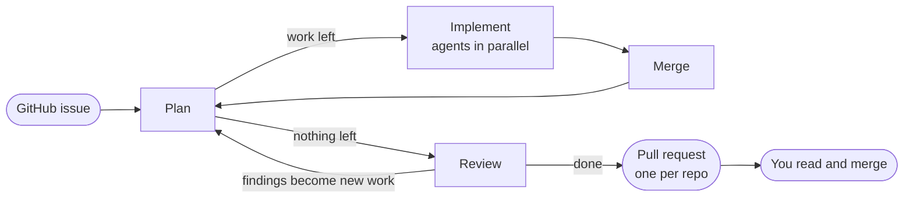
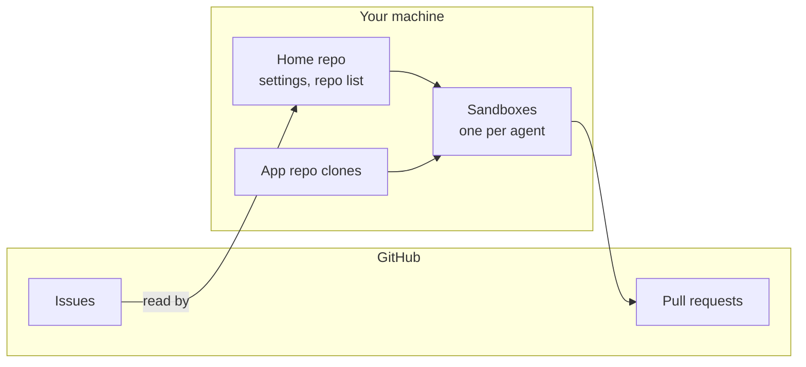

# sandcastle-factory

Hand it a GitHub issue, walk away, come back to a pull request. AI agents plan the work, write the code in parallel sandboxes, review it, and open one PR per repo they touched. Nobody is asked anything mid-run. Built on [`@ai-hero/sandcastle`](https://github.com/ai-hero-dev/sandcastle).

## Requirements and limits

- **Tools**: Node 22+, git, [`gh`](https://cli.github.com) (logged in). Windows: git bash.
- **Sandboxes**: docker or podman. Without them, see `SANDBOX=none` below.
- **GitHub only**: GitLab, Bitbucket and others are not supported. The home repo needs issues enabled.
- **At least one agent provider**, picked per phase ([details](docs/agents.md)):

  | Provider | You need |
  | --- | --- |
  | Claude Code | an Anthropic subscription or API key |
  | GitHub Copilot | a Copilot subscription |
  | Codex | an OpenAI API key, or `codex login` on the host |

## Quick start

Run in your **home repo**: the repo that holds the issues.

1. Add the onboarding skill:
   ```sh
   npx skills add dredodin/sandcastle-factory -s onboarding-factory --copy
   ```
2. In your agent, run `/onboarding-factory`. It installs the factory, asks which app repos to add, writes their check scripts and builds their images. Rerun it later to add more repos.
3. When the skill stops and asks, run setup in your own terminal (Windows: Git Bash). It asks for tokens and clone paths, which stay yours:
   ```sh
   npm run sandcastle -- setup
   ```
   Tell the agent it exited 0; the skill finishes.
4. Label an issue `ready-for-agent` and start your first run:
   ```sh
   npm run sandcastle -- take <issue>
   ```

<details>
<summary>Install by hand</summary>

In the home repo, pick a tag from [Releases](https://github.com/dredodin/sandcastle-factory/releases):

```sh
npm install --save-dev "git+https://github.com/dredodin/sandcastle-factory.git#vX.Y.Z" tsx
```

Add to `package.json`:

```json
{ "scripts": { "sandcastle": "tsx node_modules/sandcastle-factory/main.mts" } }
```

Then lay out the home repo ([layout](docs/home-repo-layout.md)) and run `npm run sandcastle -- setup`.

</details>

> [!IMPORTANT]
> **Secrets.** One fine-grained GitHub token covers every repo, and it lives in `.sandcastle/.env` next to the agent keys. Keep that file out of git and out of the agents' reach: [secrets](docs/secrets.md).

> [!WARNING]
> **`SANDBOX=none`** runs agents straight on your machine, with all your rights. Each repo's toolchain must be installed on the host.

## How a run works



Each agent checks its own work before committing. Review reads the whole branch and only files findings; the next cycles fix them. At most two review passes per run.

## Where things live



- **Home repo**: where you run the factory. Its GitHub issues hold the work; it holds the repo list and per-machine settings.
- **App repo**: any other repo the factory may change.
- **Sandbox**: where one agent works: a docker or podman container, or your machine itself with `SANDBOX=none`.

More terms: [GLOSSARY.md](GLOSSARY.md).

## Everyday commands

```text
npm run sandcastle -- take <issue>     # start fresh on an issue
npm run sandcastle -- resume <issue>   # continue its latest take in every repo, e.g. after PR comments
npm run sandcastle -- setup            # change settings, add repos
```

Setup details and one-run overrides: [commands](docs/commands.md).

## Docs

- [Home repo layout](docs/home-repo-layout.md)
- [Secrets](docs/secrets.md)
- [Agents](docs/agents.md)
- [Commands](docs/commands.md)
- [Repo image](docs/repo-image.md)
- [Contributing](CONTRIBUTING.md)
