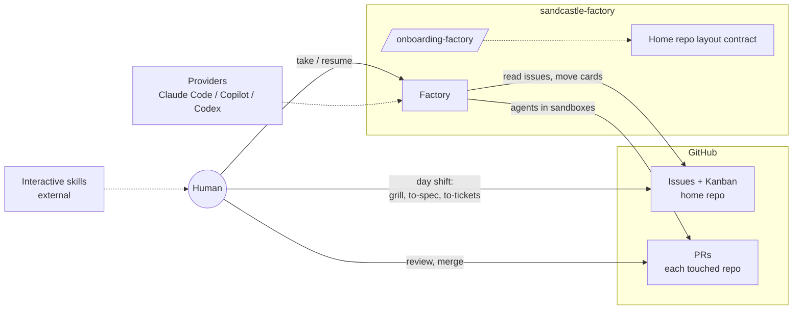
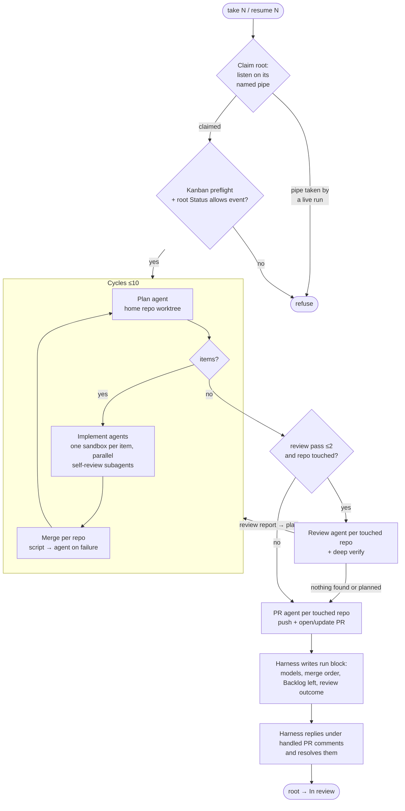
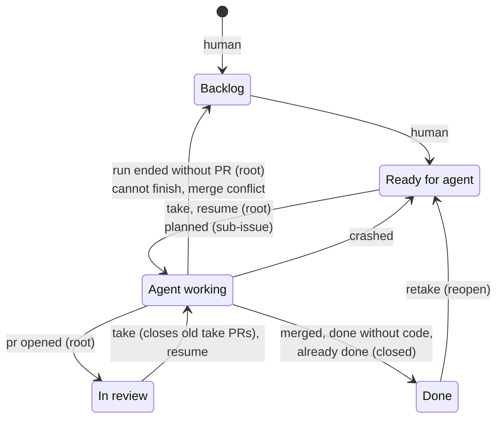
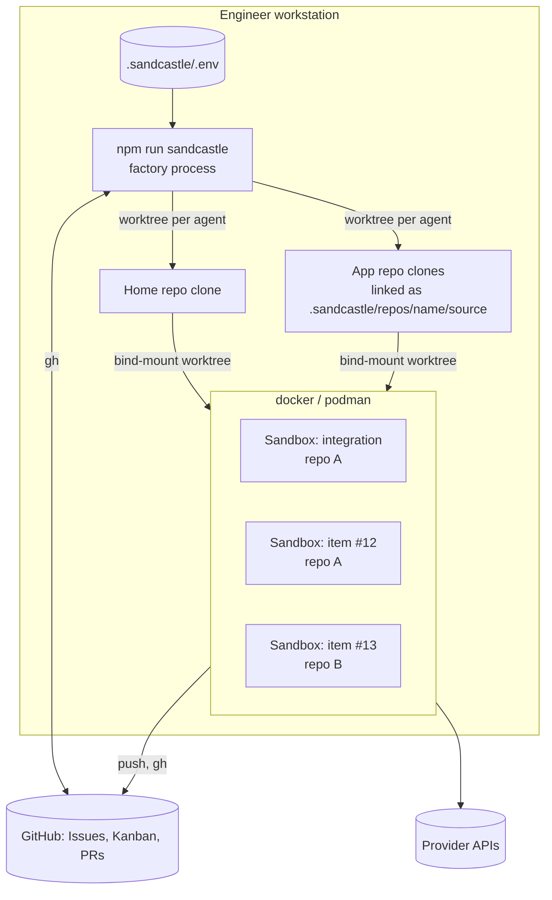

# Solution Architecture Document: sandcastle-factory v0.6.0

Snapshot of v0.6.0. Frozen: never edited after merge.

| Ver. | Description of change | Author | Date |
| --- | --- | --- | --- |
| 2.0 | As-built SAD for sandcastle-factory v0.4.2. | Dmitrii Bessonov | 02-Nov-2026 |
| 3.0 | As-built SAD for v0.5.0: agents only read GitHub; review reports and PR comments become in-run work (ADR-0008). | Dmitrii Bessonov | 03-Nov-2026 |
| 3.1 | As-built SAD for v0.5.4: a run claims its root through a named pipe per root (ADR-0009). | Dmitrii Bessonov | 03-Nov-2026 |
| 4.0 | As-built SAD for v0.6.0: app repo paths leave `.env`; the `.sandcastle/repos/` folders are the Workspace; onboarding links clones. | Dmitrii Bessonov | 07-Nov-2026 |

| Ref. | Name |
| --- | --- |
| R1 | Factory repository: github.com/dredodin/sandcastle-factory, tag v0.6.0 |
| R2 | Agent library: github.com/ai-hero-dev/sandcastle (`@ai-hero/sandcastle` 0.12.0) |
| R3 | Interactive skills: github.com/mattpocock/skills, github.com/humanlayer/skills |
| R4 | Factory glossary: `GLOSSARY.md` in R1 |
| R5 | Factory ADRs: `docs/adr/` in R1 |

## Contents

1. Executive summary
2. Introduction
3. Context
4. Requirements
5. Quality attributes
6. Baseline architecture
7. Target solution architecture
8. Transition / migration
9. Solution architecture governance
10. Architecture decision records

---

## 1 Executive summary

**sandcastle-factory** is an AFK (away from keyboard) orchestrator. You give it one GitHub issue. AI agents plan the work, write the code in parallel sandboxes, review it, and open one pull request in each repo they changed. Nobody is asked a question during the run. A human reads and merges every PR.

The product has three parts:

- **Factory**: a TypeScript/Node program. You install it into a repo as an npm package from a Git tag.
- **`/onboarding-factory` skill**: an agent skill that makes a repo a home repo and adds app repos to its Workspace.
- **Home repo layout contract**: the files that a home repo keeps for each repo of its Workspace (image recipe, setup, verify and optional scripts).

The factory knows no particular repo. All repo-specific data lives in the home repo. Any team on GitHub can use it.

## 2 Introduction

### 2.1 Definitions, acronyms, abbreviations

The terms follow the factory glossary (R4).

| Term | Definition |
| --- | --- |
| ADR | Architecture Decision Record. It records why a decision was made and which alternatives were rejected. |
| AFK agent | An agent that works without a human in the loop. |
| App repo | Any repo of the Workspace other than the home repo. |
| Cycle | One plan → implement → merge pass in a run. A run repeats cycles until the plan is empty. |
| Deep verify script | The optional slow check of a repo. Review runs it once on the whole branch. Its output goes into the review report. |
| Factory | The program that turns one issue tree into pull requests. It runs each phase as an agent in a sandbox. |
| Home repo | The repo that the factory runs from. It holds the issues, the repo folders and the per-machine settings. |
| Integration branch | The branch where a take collects its work. There is one per touched repo, with the same name in each repo. |
| Issue | A GitHub issue in the home repo. This is the basic unit of work. |
| Item | One unit of work that the plan gives to one implement agent: an unblocked sub-issue in Ready for agent, the root issue when it has no sub-issues, or work that the plan writes as text from a review report, PR comments or plan check output (no issue, no Kanban card). An item is always in one repo. |
| Item branch | The short-lived branch of one item. The factory merges it into the integration branch. |
| Kanban | The GitHub Project of the home repo. |
| Own reply | A comment that an agent posts under the account of the engineer who started the run, with a marker. The factory never reads it as a request. |
| Phase | One step of a run: plan, implement, merge, review or PR. |
| Plan check script | The optional check of the home repo that finds due work. The plan agent runs it in each cycle. When it fails, its output becomes a work item. |
| Provider | The agent runtime of a phase: Claude Code, GitHub Copilot CLI or Codex. |
| Repo image | The container image for the agents of one repo. It starts from the factory base image. |
| Repo label | The `repo:<name>` label on an issue. It names the repo where the work is done. No label means the home repo. |
| Review report | What branch review prints for one repo: its findings, or nothing. It lives only inside the run. |
| Resume | A run that continues the latest take of a root issue from the state where it stopped. |
| Root issue | The issue that a run starts on. Its direct sub-issues are the work. |
| Run | One start of the factory on a root issue: a take or a resume. |
| Sandbox | The isolated place where one agent works: a docker or podman container, or the host when `SANDBOX=none`. |
| Spec | An issue that the `/to-spec` skill writes. It is usually a root issue. |
| Status | The column of an issue on the Kanban: Backlog, Ready for agent, Agent working, In review or Done. |
| Take | A run that starts new integration branches for a root issue. Takes of one root issue have the numbers 1, 2, 3… |
| Ticket | An issue that the `/to-tickets` skill writes. It is usually a sub-issue of a spec. |
| Verify script | The check of a repo. Each agent runs it before each commit. When it fails, the agent does not commit. |
| Wizard stage | One step of the setup wizard. |
| Workspace | The home repo and all the app repos that it lists. |

### 2.2 Solution architecture stakeholders

| Role | Interest |
| --- | --- |
| Factory maintainer | Develops and releases the factory. Keeps it free of repo-specific knowledge. |
| Home repo owner | Onboards a repo as a home repo. Keeps the Workspace list, the repo images and the scripts of each repo. |

## 3 Context

### 3.1 Technology strategy

- **GitHub only.** GitHub hosts code, issues, sub-issues, issue dependencies (`blockedBy`), the Kanban (GitHub Projects) and PRs. GitLab, Bitbucket and other hosts are not supported.
- **Built on `@ai-hero/sandcastle`.** The library gives worktrees, sandboxes and agent providers. The factory adds the multi-repo workflow, the Kanban state machine and the phases.
- **Provider-neutral.** Each phase selects its provider, model and effort. A team can use the AI subscription it already has.
- **Local execution.** The factory runs on the workstation of the engineer. There is no server, no queue and no scheduler.

### 3.2 Security architecture

- An agent acts on GitHub with the token of the person who starts the run. PRs and comments show that person as the author.
- Each agent runs in its own sandbox. The sandbox gets the secrets of `.sandcastle/.env` and no other host environment: `GH_TOKEN` and every provider key that is filled in, whether a phase uses that provider or not.
- Secrets are only in `.sandcastle/.env`. The setup wizard is the only writer of this file. Git ignores it. The onboarding skill adds deny rules so that Claude Code cannot read or edit it.

## 4 Requirements

### 4.1 Business goals

| ID | Goal |
| --- | --- |
| BG1 | Deliver one change across several repos with no human in the loop between the plan and the PR. |
| BG2 | Make sure that a human sees only work that has passed the repo checks and an agent review. |
| BG3 | Let any GitHub team adopt the factory without changes to the factory code. |

### 4.2 Functional requirements

| ID | Requirement | Goal |
| --- | --- | --- |
| FR1 | Start a take on a root issue. Plan its unblocked sub-issues in dependency order. | BG1 |
| FR2 | Implement each item in its own sandbox, in parallel. Self-review the item before the commit. | BG1, BG2 |
| FR3 | Merge item branches into the integration branch of each repo. Use a script when there is no conflict, and an agent when there is a conflict. | BG1 |
| FR4 | Review the whole integration branch of each touched repo. Hand the findings to the plan as a review report, and implement them in the next cycles. | BG2 |
| FR5 | Open or update one PR in each touched repo. Give the merge order when the change spans several repos. | BG1 |
| FR6 | Resume the latest take: sync the branches, turn open PR comments into work, continue, and reply under each handled comment after the push. | BG1 |
| FR7 | Show the state of each issue on the Kanban, and move it at each event of the run. | BG1 |
| FR8 | Onboard a home repo and add app repos with one skill and one setup command. | BG3 |
| FR9 | Let each phase use a different provider, model and effort. | BG3 |

### 4.3 Constraints

- **C1.** GitHub only. The home repo must have issues enabled and a Kanban with exactly five Status options and three built-in workflows switched on.
- **C2.** Node 22+, git and a logged-in `gh` on the host. On Windows, Git Bash.
- **C3.** Docker or podman for sandboxes. Without them, `SANDBOX=none` runs agents on the host.
- **C4.** All issues of a run are in the home repo (ADR-0006).
- **C5.** Single machine only: a second run on a root is refused only on the machine whose run holds the pipe (ADR-0009).

### 4.4 Assumptions

- **A1.** The verify script of each repo is a sufficient gate for an agent commit.
- **A2.** The root issue and its sub-issues are clear enough for an agent to implement them without questions. The interactive skills (`/grill-with-docs`, `/to-spec`, `/to-tickets`) help a human to write them.
- **A3.** The engineer has an account with at least one supported provider.

## 5 Quality attributes

### 5.1 Key quality attributes

Each metric is an invariant that the code or the release process makes true.

| Priority | Quality attribute | Measurable metric |
| --- | --- | --- |
| 1 | Security (write control) | Agents only read GitHub. Their only writes are the push and PR of the PR phase. The harness alone writes issues, comments and the Kanban (ADR-0004, ADR-0008). |
| 2 | Reviewability | Each commit follows a green verify script. Each item gets a fresh-context self-review. Each run has at most 2 branch review passes. Each repo gets at most 1 PR per take. |
| 3 | Testability (factory) | The mutation score of the pure modules is 100 % (ADR-0001). |
| 4 | Traceability | Each item is an issue. Each commit has `Issue: #<N>`. Branch names contain the home repo, the root issue and the take number. |
| 5 | Usability (onboarding) | One skill (`/onboarding-factory`) and one command (`setup`) make a home repo ready. |
| 6 | Portability (providers) | Each of the 5 phases can use Claude Code, Copilot or Codex. A change of provider is a change of settings, not of code. |
| 7 | Recoverability | A crash returns the sub-issues to Ready for agent and keeps the root issue in Agent working. `resume` continues from there. |

## 6 Baseline architecture

Before v0.4, the harness lived in one hub repo of one team:

- The orchestrator was code in `.sandcastle/` of the hub. Other teams could not reuse it without a copy.
- Tickets were sub-issues in the app repos. The spec was in the hub.
- Copilot CLI was the only agent runtime. Docker was the only sandbox.
- Implement and review ran in a loop of up to 10 iterations for each ticket. The review agent changed code itself.
- The primary PR closed the spec.
- There was no Kanban and no resume. A failed take restarted as a new take.
- E2E tests ran the real workflows against persistent test repos, and an AI judge checked them.

## 7 Target solution architecture

### 7.1 Conceptual view



The work has two shifts:

1. **Day shift (interactive).** A human and an interactive agent write a spec and its tickets in the home repo. The skills are external to the factory, and the onboarding skill installs them. The human sets each ticket's repo label and `blockedBy`, then moves the tickets and the root issue to Ready for agent.
2. **Night shift (AFK).** The engineer starts `take <issue>`. The factory runs without a human until it has opened the PRs.

Long AFK runs are possible because the plan is agreed before the run, and because the environment gives the agents feedback: verify scripts, self-review subagents and branch review.

### 7.2 Logical view

#### 7.2.1 Components

```text
main.mts                 # CLI: setup | take N | resume N
workflow/
├── setup.mts, wizard.sh # reads the layout, opens the wizard, checks the source links, creates repo labels
├── take.mts             # new integration branches, cycles, finish
├── resume.mts           # finds the latest take, syncs with origin, cycles, finish
└── cycle.mts            # cycle loop (≤10), review passes (≤2), PR phase
phases/<phase>/          # plan, implement, merge, review, pr: the code and the prompt of each phase
shared/
├── kanban.mts           # Status state machine (pure) + gh calls
├── sandbox.mts          # worktree + sandbox for each agent; integration worktrees
├── workspace.mts        # home repo + app repos from the .sandcastle/repos/ folders
├── claim/               # the run claim: start-decision.mts (pure: pipe name, hold / clear stale / refuse), pipe-claim.mts (thin shell: listens on the root's pipe), tests beside
├── env.mts, agents.mts  # .env schema; provider, model and effort for each phase
└── branches.mts, pr-body.mts, …  # pure naming and assembly logic
skills/onboarding-factory/
skills/run-factory/       # SKILL.md and known-issues.md: failure phrase → fix table
Containerfile            # base image sandcastle-factory:base
```

Pure logic is in `shared/`. Calls to `git`, `gh` and files are thin one-line wrappers beside it.

#### 7.2.2 Run workflow



- **Claim** comes first, before any Kanban read-for-write or card move. The run listens on the named pipe of its root, built from repo `owner/name` and root number (a Windows named pipe, or a Unix domain socket in `/tmp/sandcastle-factory/`). Listening works: the run holds the root for its whole life. Taken and a connection is accepted: a live run, so the start is refused, naming repo#root and its start time if it answers. Taken and refused (a socket file a dead process left): the file is removed and the run listens again. The holder answers JSON `{ repo, root, startedAt }` from the main thread: the OS accepts connections while the run blocks. If the server fails mid-run, it logs `log.error`. A killed process frees the pipe or leaves a dead socket file, so `resume` needs no cleanup.
- **Plan** runs in the integration worktree of the home repo. It reads the root issue and its Ready for agent sub-issues. It turns review reports, PR comments (on resume) and plan check output into work items, and returns the items, the findings it rejects (each with a reason) and the PR comments it handled. It writes nothing to GitHub. Order comes only from `blockedBy`. Labels only route an item to a repo.
- **Implement** writes the item test-first where there is a seam. Then it starts fresh-context subagents: Standards (when the diff has code), Docs (when the diff has code or Markdown) and Spec (always). It fixes their findings, runs the verify script and commits. It reports one outcome: `committed`, `done without code`, `already done` or `cannot finish`. A work item moves no card: its outcome is only logged.
- **Merge** first tries one script chain: merge each item branch in order, then run the verify script. When the chain fails, it resets, and the merge agent resolves the conflicts. The default branch is merged in first when the integration branch conflicts with it.
- **Review** reads the whole integration branch of one repo against its default branch. It applies a code review (Standards and Spec) and a doc review (Convention and Spec). It commits nothing and writes nothing to GitHub. It prints one review report; the second pass gets the findings the plan rejected after the first (ADR-0003, ADR-0008).
- **PR** pushes the integration branch and opens or rewrites the PR. The PR closes no issue. The harness then adds a run block: the models, the merge order across repos, the repos without a PR, the sub-issues left in Backlog, and the review outcome of the repo per pass (its report, then findings fixed, rejected with reasons, left over). Then it posts one reply under each handled PR comment ("fixed in <merge commit>", the reason, or the question) and resolves it, needs info excepted.

#### 7.2.3 Kanban state machine

The Status of each issue is the state of the run (ADR-0007). The harness alone moves cards (ADR-0004).



- The factory refuses to start when the Status options are not exactly the five above.
- The factory reads the root and its sub-issues with one GraphQL query that returns each Status.
- A new take from In review closes the open PRs of the old take, and reopens the sub-issues that the old take closed.
- A human closes the root issue after the last PR is merged.

### 7.3 Data view

| Data | Store | Rules |
| --- | --- | --- |
| Root issue, sub-issues | GitHub Issues of the home repo | The repo label routes. `blockedBy` orders. Only direct sub-issues are items. |
| Status | Kanban (GitHub Project of the home repo) | Five options. Built-in workflows: closed → Done, reopened → Ready for agent. |
| Review reports, rejected findings, handled PR comments, how each item ended | Harness memory, for one run | Never persisted. A resume starts empty and re-reviews. |
| Code changes | Integration branch `sandcastle/<home>/issue-<N>-take-<K>` and item branches in each repo | The same integration branch name in each repo. An item branch name is never used again. |
| Commits | Each repo | Subject starts with `SANDCASTLE:`. Body has `Issue: #<N>`. |
| PR | Each touched repo | One for each take. The run block is between `<!-- sandcastle-run -->` markers. |
| Workspace list | Folders of `.sandcastle/repos/` | Minus the home repo's. Each app repo's `source` link, made by onboarding, is the only record of its clone; missing or not a git clone fails the run. |
| Repo files | `.sandcastle/repos/<name>/` in the home repo | `Containerfile`, `setup.sh`, `verify.sh`; optional `deep-verify.sh`, `plan-check.sh` (home repo only), `CODING_STANDARDS.md`, `sparse-checkout`, `mounts`. The factory copies them into each worktree. |
| Settings and secrets | `.sandcastle/.env`, for each machine | Only the wizard writes it. A shell variable overrides a known key for one run. |
| Run claim | A named pipe per root (Windows) or a socket file in `/tmp/sandcastle-factory/` (Linux, macOS), for one run | The OS frees the Windows pipe when the process dies; a dead POSIX socket file is removed by the next run. |
| Run logs | `.sandcastle/logs/<run>/` | `console.log` plus one numbered file `<NNN>-<base>-<repo>.log` for each agent run. Each file starts with the provider, model and effort. Git ignores the logs. |

### 7.4 Infrastructure / deployment view



- **Base image** `sandcastle-factory:base`: Node 22, git, gh, jq, Claude Code, Copilot CLI, Codex CLI, and an `agent` user with the host UID and GID.
- **Repo image** `sandcastle:<home>-<name>`: built from the `Containerfile` of each repo. It adds the tools that the verify script needs.
- Each agent gets its own worktree, mounted into its own sandbox. Each touched repo also gets an integration worktree and sandbox for plan, merge, review and PR.
- In each new sandbox, the factory first runs `gh auth setup-git`, so git uses `GH_TOKEN`. Then the repo's `setup.sh` runs once.
- An optional `sparse-checkout` list makes the worktrees of large repos smaller.
- The factory is installed in the home repo with `npm install git+https://github.com/dredodin/sandcastle-factory.git#vX.Y.Z` and runs with `tsx`.

### 7.5 Addressing key quality attributes

#### 7.5.1 Security

- One sandbox for each agent bounds the damage of an agent that runs with all tools allowed.
- The sandbox gets only the secrets of `.sandcastle/.env`.
- ADR-0004 and ADR-0008 state who writes what. Agents only read GitHub. The harness makes the Kanban, issue-state and PR-comment writes from the reported result of an agent. The prompts state only what each phase may write.
- A PR reaches the default branch only when a human merges it.
- With `SANDBOX=none`, agents run with all the rights of the engineer. The README warns about this.

#### 7.5.2 Usability

- Onboarding: `npx skills add dredodin/sandcastle-factory -s onboarding-factory --copy`, then `/onboarding-factory`, then `npm run sandcastle -- setup`. A rerun of the skill adds more app repos.
- Daily use: three commands, `take <issue>`, `resume <issue>` and `setup`.
- The Kanban shows the progress of each issue.

#### 7.5.3 Traceability

- An item is an issue or work the plan wrote. Review findings and PR comments become work, not issues; the PR description records each review's findings, and the run log holds the full reports.
- Each commit refers to its issue, or to the root issue for work. The factory comments on each sub-issue when it moves it.
- The PR run block shows the models of each phase and the merge order across repos.

#### 7.5.4 Reviewability

- Implement reviews its own work with fresh-context subagents, and then fixes it (ADR-0003).
- Branch review reads the whole branch and prints its findings. It does not change code, so all code changes get an item-level review.
- The PR template has Summary, Evidence (before and after) and Merge Danger (one-way or two-way door, blast radius).

#### 7.5.5 Testability

- The harness tests its pure logic with `node:test`. `npm run verify` runs the typecheck and the tests before each commit (ADR-0001).
- `npm run mutate` (Stryker) checks that the tests catch each change of a decision. The target is 100 % for the pure modules.
- There are no fakes of shell, git, gh, agents or sandboxes. Code that makes a decision is a pure function. The call to git or gh is a thin wrapper beside it.
- E2E tests on live repos are deferred because they cost too much for what they find.

#### 7.5.6 Maintainability

- The factory knows no particular repo (AGENTS.md). All repo-specific data is in the home repo.
- The prompts state goals, not prohibitions. ADR-0004 and ADR-0008 hold the write rules.
- Each PR to the factory raises the version. CI publishes a prerelease for each PR and a release on each merge to main.

#### 7.5.7 Portability

- The provider, model and effort of each phase are settings (`<PHASE>_PROVIDER`, `_MODEL`, `_EFFORT`).
- Claude Code (subscription or API key), Copilot (fine-grained token) and Codex (API key or host `codex login`) are supported.
- Docker, podman or no sandbox.

### 7.6 Architecture constraints and limitations

- An AFK run is only as good as its spec and tickets. The factory asks no questions. An under-specified item stops with `cannot finish`.
- **Tokens.** A personal-account Kanban needs a classic `GH_TOKEN` (`repo`, `project`, `workflow`, `read:org`, `read:discussion`): fine-grained tokens cannot reach a user-owned Project. For an organisation-owned Kanban, a fine-grained `GH_TOKEN` is enough. The Copilot provider needs a second, fine-grained token (`COPILOT_GITHUB_TOKEN`).
- The token in the sandbox has the full rights of its scopes. ADR-0004 controls what agents write through the prompts, not through the token.
- The Kanban built-in workflows cannot be checked before a run. When a workflow is off, the run fails at the first move that needs it.
- Only one level of sub-issues is planned.
- Libraries that open the repo through libgit2 do not work in a sandbox (ADR-0005).
- Runs on two machines are not detected: the claim is local (ADR-0009).

### 7.7 Risks and mitigations

| Risk | Mitigation |
| --- | --- |
| A wrong agent change reaches the default branch | Verify script before each commit, item self-review, branch review, human merge |
| A token leaks from a sandbox | Only `.env` secrets in the sandbox; `.env` git-ignored and denied to agents; one sandbox for each agent |
| A broad classic token gives agents more rights than they need | Use a fine-grained token for an organisation-owned Kanban; ADR-0004 write rules |
| An agent loops or hangs | ≤10 cycles, ≤2 review passes, 3 600 s idle timeout for each agent |
| A run crashes in the middle | Sub-issues go back to Ready for agent, the root issue stays in Agent working, and `resume` continues |
| A provider or model update changes behavior | The provider and model of each phase are settings, and the PR run block records them |
| A change to the factory breaks its decisions | 100 % mutation score of the pure logic; prerelease for each PR |

### 7.8 Solution costs and cost management

- **Infrastructure:** none. The factory runs on the workstation of the engineer.
- **Licenses:** the subscription or API keys of the providers that the team already has.
- **Run cost:** provider usage. Each phase selects its own model and effort, so plan, merge and PR can use a cheaper model than implement and review. The cycle and review-pass caps limit the cost of one run.

## 8 Transition / migration

### 8.1 Migration approach

A home repo moves from the in-hub harness to the packaged factory as follows:

1. Remove the in-repo orchestrator code from `.sandcastle/`.
2. Add the onboarding skill and run `/onboarding-factory`. It installs the interactive skills, the factory package at the newest release tag, the layout, the ignores and the deny rules. It also writes the `Containerfile`, `setup.sh` and `verify.sh` of each repo.
3. Create or link the Kanban, with five Status options and three built-in workflows.
4. Run `npm run sandcastle -- setup` in a terminal. Enter the tokens, the models, the sandbox engine and the Kanban.
5. Move open tickets from the app repos to the home repo as sub-issues of their spec, each with a repo label.
6. Put a root issue in Ready for agent and start `take`.

A factory upgrade is a change of the tag in `package.json`. The human decides when to upgrade.

## 9 Solution architecture governance

### 9.1 Solution architecture design

- Factory decisions are ADRs in `docs/adr/` of the factory repo. A home repo keeps its own decisions.
- The factory glossary defines the vocabulary of the code, the prompts and the docs. Review checks Markdown against it.

### 9.2 Development

- Changes to the factory go through PRs. `npm run verify` must pass before each commit.
- Each PR raises `version`. On `0.x`, a breaking change raises the minor version.
- CI publishes `v<version>-pr.<PR>.<n>` for each PR push, deletes the prereleases when the PR closes, and releases `v<version>` on each push to main.
- The factory develops itself: it is an app repo in the Workspace of another home repo, and takes there change it.

### 9.3 Quality assurance

- `npm run verify` does the typecheck and the unit tests.
- `npm run mutate` does the mutation testing (Linux only).
- A human reviews each PR.

## 10 Architecture decision records

The ADRs are in `docs/adr/` of the factory repo.

| ADR | Title | Status |
| --- | --- | --- |
| 0001 | The harness tests its pure logic | accepted |
| 0002 | Review the whole branch once per repo | superseded by 0003 |
| 0003 | Review finds, implement fixes | accepted |
| 0004 | Who writes what | accepted |
| 0005 | Sandbox git is read through the `git` CLI | accepted |
| 0006 | Issues live in the home repo; a repo label routes them | accepted |
| 0007 | The Kanban Status is the state of a run | accepted |
| 0008 | Agents only read GitHub | accepted |
| 0009 | A run claims its root through a named pipe per root | accepted |

### 10.1 ADR-0001: The harness tests its pure logic

**Decision.** The harness tests its pure logic, and `npm run verify` runs the tests. Agents that work on the factory get deterministic feedback before they commit. Tests only cover functions with several outcomes. Expected values are literals. There are no fakes of shell, git, gh, agents or podman: a decision is extracted as a pure function. Mutation testing checks the pure modules at 100 %.

**Consequences.** A proposal for dependency injection or fakes repeats what this rule excludes.

### 10.2 ADR-0002: Review the whole branch once per repo (superseded)

**Decision.** One review agent for each touched repo reviews the whole integration branch and commits its fixes. **Superseded by ADR-0003**, because the fixes of the review agent were not reviewed.

### 10.3 ADR-0003: Review finds, implement fixes

**Decision.** Implement writes the item, reviews it with fresh-context subagents (Standards, Docs, Spec) and fixes it. Branch review only finds problems; the next cycles implement them (how findings travel: ADR-0008). A run has at most two review passes.

**Rejected.** Review fixes code (unreviewed fixes). Implement and review as two sandboxed agents for each item (cost and complexity).

**Consequences.** Every code change gets an item-level review.

### 10.4 ADR-0004: Who writes what

**Decision.** The harness changes issues and the Kanban. Only the PR phase pushes. Agents never merge a PR, close an issue, comment, or move a card. The one exception is the push and PR of the PR phase (ADR-0008). Prompts state goals and allowed writes, not prohibitions.

**Consequences.** A prompt that adds a prohibition again duplicates this ADR.

### 10.5 ADR-0005: Sandbox git is read through the `git` CLI

**Decision.** The verify, deep verify and plan check scripts read git through the `git` CLI. Libraries that open the repo through libgit2 fail in a sandbox. The cause is not diagnosed until a script needs libgit2.

**Consequences.** Diff-based tools get the changed files from `git diff`. Stryker.NET `--since` and `--with-baseline` are not available in a sandbox.

### 10.6 ADR-0006: Issues live in the home repo; a repo label routes them

**Context.** One change can touch several repos. When tickets live in the app repos, the work is spread across several trackers, and the factory needs access to the issues of each repo.

**Decision.** All issues of a run (spec, tickets) are in the home repo. The `repo:<name>` label names the repo where the work is done. No label, two repo labels or an unknown name mean the home repo. Setup creates one label for each app repo. Labels never decide eligibility: `blockedBy` is the only order. Only direct sub-issues of the root issue are items.

**Rejected.** Tickets as cross-repo sub-issues in the app repos. Labels for order or eligibility.

**Consequences.** One tracker and one Kanban hold the whole change. App repos need no issue access. Commits in app repos refer to home repo issues. The person who slices a spec must set the repo label.

### 10.7 ADR-0007: The Kanban Status is the state of a run

**Context.** An AFK run must show its progress, survive a crash, and refuse to start twice on the same root issue.

**Decision.** The Status of each issue on the GitHub Project of the home repo is the state of the run. A pure state machine says which event may move which Status. The harness alone moves cards. The factory refuses to start when the Status options are not exactly Backlog, Ready for agent, Agent working, In review and Done. The built-in workflows Item closed → Done and Item reopened → Ready for agent must be on. A crash returns the sub-issues in Agent working to Ready for agent and keeps the root issue in Agent working.

**Rejected.** Labels as state. A local state file.

**Consequences.** Humans and the factory see the same state. A crash leaves a state that `resume` can read. Each home repo needs a GitHub Project with a fixed Status field and two built-in workflows, and `GH_TOKEN` needs Project access.

### 10.8 ADR-0008: Agents only read GitHub

**Context.** The review agent created, linked and labelled its own findings issue, and the harness found it by diffing sub-issues. A forgotten link lost the findings, a wrong label misrouted them, and review issues outlived the take, so a retake did not start clean.

**Decision.** Agents write nothing to GitHub; the PR phase's push and PR are the only agent writes. Review prints a review report per repo. The plan turns reports, PR comments and plan check output into work items that live only inside the run, and rejects findings with a reason. The harness keeps an in-memory record of the run. After the push it replies under each handled PR comment and resolves it, needs info excepted.

**Rejected.** A retake that reads the old take's PR comments (couples takes). Persisting findings or comment decisions across runs (a resume re-reviews anyway).

**Consequences.** A review cannot lose or misroute findings. A retake starts from the spec alone. The built-in workflow Item added → Backlog is no longer needed.

### 10.9 ADR-0009: A run claims its root through a named pipe per root

**Context.** ADR-0007 promises a run refuses to start twice on one root, but the Status cannot tell a crashed run from a live one.

**Decision.** Before any Kanban read-for-write or card move, a run listens on the named pipe of its root (exact name from repo and root number) and holds it for its whole life. Taken by a live run (a connection is accepted): refuse, naming repo#root and its start time if it answers. Taken by a dead POSIX socket file: remove it and listen again. The start decision is pure and table-tested; the I/O is a thin shell.

**Rejected.** A pool of local ports: the pool size caps parallel runs, simultaneous starts need a tie-break, and free is told from foreign only by timing and fetch-error internals. A lock ref on GitHub. A PID file. A port derived from the issue number. One fixed port per machine. A long-running server.

**Consequences.** Nothing needs cleanup by hand: a killed process frees the pipe or leaves a socket file the next run removes. Accepted risk: after a run died, two starts at the same instant can both run. Parallel runs on different roots are unlimited. Runs on two machines are not covered.
